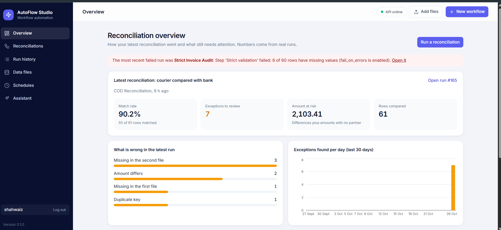
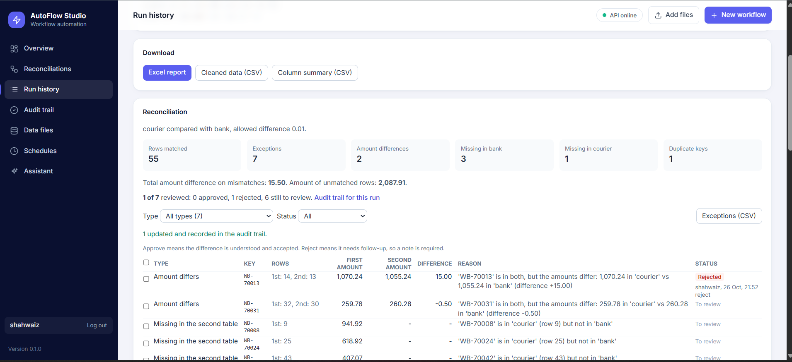
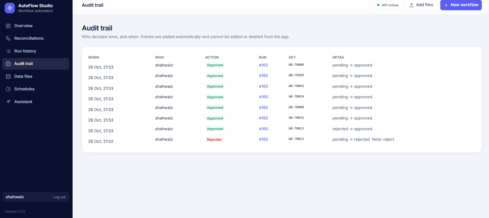

# AutoFlow Studio

A business workflow automation platform. You build workflows from simple steps, run them, and watch the results. Everything runs locally and uses free tools. **All data in this project is fictional.**

> Status: v0.6, work in progress. The sections below say exactly what works and what does not.

## What it is for

Finance and operations teams spend hours every day checking one list against another: cash collected by couriers against bank deposits, payments against invoices. AutoFlow Studio does that matching for you and hands back a short list of **exceptions**, each with a reason in plain words, so people only look at what is actually wrong.

## What works today

**The core: COD reconciliation**

- **Match and compare.** Choose a courier collections file and a bank deposits file (CSV or Excel). Each waybill is matched to its bank reference, ignoring case and stray spaces, and the amounts are compared within an allowed difference. Matching is one row to one row.
- **Exceptions with reasons.** Everything that does not agree is listed: amount differs, missing in the bank file, missing in the courier file, duplicate waybill, amount missing or unreadable, no key. Each says which row it is in. The run page has totals, a filter and a CSV download. Up to 5,000 exceptions per run are stored.
- **Review and audit trail.** On a run page, check one or more exceptions and Approve (the difference is understood and accepted), Reject (needs follow-up, a note is required) or Reopen. Each exception shows who decided, when and the note, and the run shows "3 of 7 reviewed". Every decision is written to an Audit trail page with who, when and what changed. The app can add entries but never edit or delete them (also blocked in the database layer). The Overview counts what is still to review, and the exceptions CSV includes the decisions.
- **Reports.** An Excel workbook with Summary, Exceptions, Columns and Data sheets, and the exceptions as CSV. Text that looks like a formula is neutralised.
- **Messy data tolerated.** Amounts like "SAR 1,234.50" or "(500.00)", dates in mixed formats and untidy references can be tidied first. Anything unreadable is counted and shown, never guessed.
- **Overview page.** The latest reconciliation (match rate, exceptions, amount at risk), what is wrong by type, exceptions per day, and recent runs. Every number comes from stored results.
- **Run history.** Every run, which files it used, a step-by-step log and a flow diagram showing the path it took.
- **Schedules.** Run a reconciliation every few minutes, daily or weekly. Only while the backend is running, and workflows that need you to choose files are skipped and say why.
- **Alert step.** "Alert finance if there are exceptions". Alerts are written to the run log. Nothing is emailed yet.

**Around it**

- **Data files.** Add, preview and delete CSV and Excel files. Files are stored under random names.
- **Reconciliations page.** Run a saved workflow on files you choose at that moment (or add one on the spot). It runs in the background so the page never freezes.
- **Template and visual builder.** Start from the COD Reconciliation template, or draw your own with drag and drop. A drawing is checked before saving. Only a fixed list of step types can run, so no user-written code is executed.
- **Assistant (rules-based, not an AI model).** Describe a reconciliation in plain English and get a proposed workflow with the reason for each step. It can also explain a workflow and summarise why runs failed. It is free and works offline.
- **Login.** One owner account, scrypt password hashing, HttpOnly session cookie, lockout after five wrong passwords, origin check on changes.
- **Tests.** 164 backend tests (pytest) and 76 frontend tests (Vitest).

## Not built yet

A workflow step that pauses a run until someone approves it (review happens after the run, on its page), many-to-one matching (one deposit covering many parcels), anomaly flags, emailed notifications, folder watching, multiple users and roles, a language-model assistant. The old .xls format is not supported.

## Sample data

Two fictional files, `courier_collections.csv` (61 rows) and `bank_deposits.csv` (58 rows), with 7 planted differences: 3 collections never deposited, 2 amounts that differ, 1 deposit nobody collected and 1 duplicate waybill. The right answer is known (55 matched, 7 exceptions), which is how the tests check the matching. Versions before this one shipped unrelated demo workflows and randomly generated runs. They were removed, and on start-up any such leftovers that you never used are cleaned away.

## Technology (all free)

React, TypeScript, Vite, Tailwind CSS, Recharts, React Flow, Python, FastAPI, SQLAlchemy, SQLite, Pandas, pytest, Vitest.

## Run it on Windows 11

You need Python 3.12 or 3.13 and Node.js 20 or newer. Use two PowerShell windows and run the commands one at a time.

**Window 1: backend**
```powershell
cd autoflow-studio\backend
py -3.13 -m venv .venv
.venv\Scripts\Activate.ps1
pip install -r requirements.txt
python -m pytest
python -m uvicorn app.main:app --port 8000
```

**Window 2: frontend**
```powershell
cd autoflow-studio\frontend
npm install
npm test
npm run dev
```

Open http://localhost:5173. The API documentation is at http://127.0.0.1:8000/docs.

## How it is built

```
backend/app/
  main.py         API routes and a consistent error format
  engine.py       workflow execution (whitelisted step types)
  definitions.py  checks every workflow the editor saves
  analytics.py    overview numbers from stored reconciliation results
  assistant.py    rules-based assistant: propose, explain, failure insights
  schedules.py    schedules and the background scheduler thread
  runqueue.py     in-memory background run queue with one worker
  datasources.py  lists, previews and deletes CSV files safely
  auth.py         password hashing, sessions, login limits
  models.py       Workflow, Execution, ExecutionStep, ExecutionInput tables
  tables.py       reading CSV and Excel files, and cleaning amounts, dates and text
  review.py       approving and rejecting exceptions, with audit entries
  seed.py         the COD sample files and built-in workflow (safe to run many times)
  templates.py    ready-made workflow templates
  reconcile.py    the matching logic behind the Compare step
frontend/src/
  pages/          Overview, Reconciliations, Builder, Templates, Run history, Audit trail, Assistant, Schedules, Data files, Account
  flow.ts         layout and checks for the flow diagrams and the builder
  components/     shared UI, the flow diagram and the settings form for each step type
```

## Safety choices

- Workflows are data, not code. Unknown step types and settings are rejected.
- CSV files are read only from fixed folders, and uploads are stored under random names.
- Uploads are limited by type, size (5 MB) and row count (50,000).
- Exported CSV files neutralise text that Excel could treat as a formula.

## Known limitations

- The background queue lives in memory and has one worker. For many users or very long jobs, use a real job system (for example Celery or RQ with Redis).
- The audit trail is tamper-resistant inside the app, not against someone who edits the database file directly. Use a real database with restricted permissions for that.
- Login is for one owner only. Do not put this on the internet without HTTPS.
- The database has no migration tool yet. Add one (Alembic) before changing tables on real data.

## Screenshots

**Overview.** The latest reconciliation: match rate, exceptions, amount at risk, what is wrong by type, and exceptions per day.



**A reconciliation run.** 55 rows matched and 7 exceptions, each with a plain reason. Exceptions can be approved or rejected with a note.



**Audit trail.** Who decided what, and when. Entries cannot be edited or deleted from the app.



**Execution log.** Every step of a run, with timing and error messages.


**Drag-and-drop builder.** Drag steps onto the canvas, draw arrows, and edit a box's settings on the right.


All data shown is fictional.
