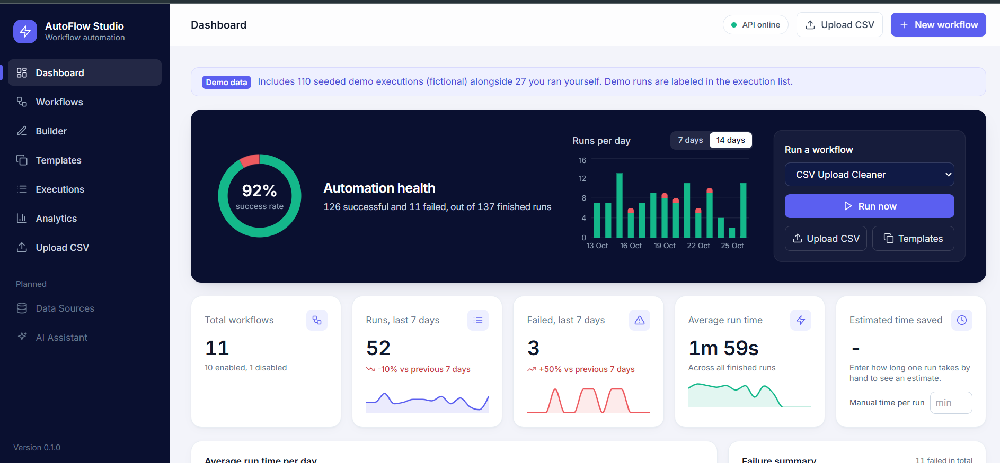
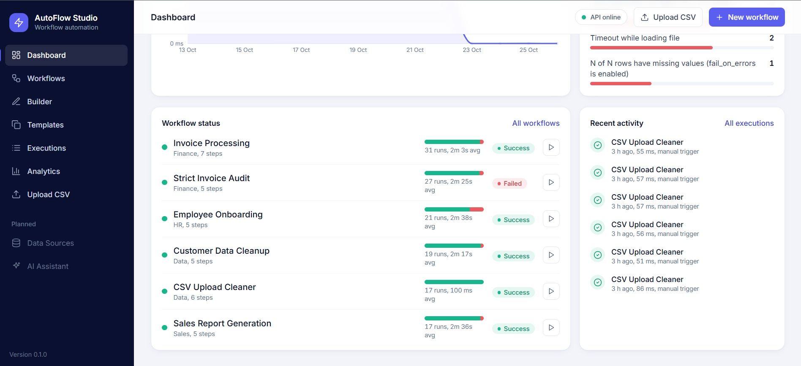
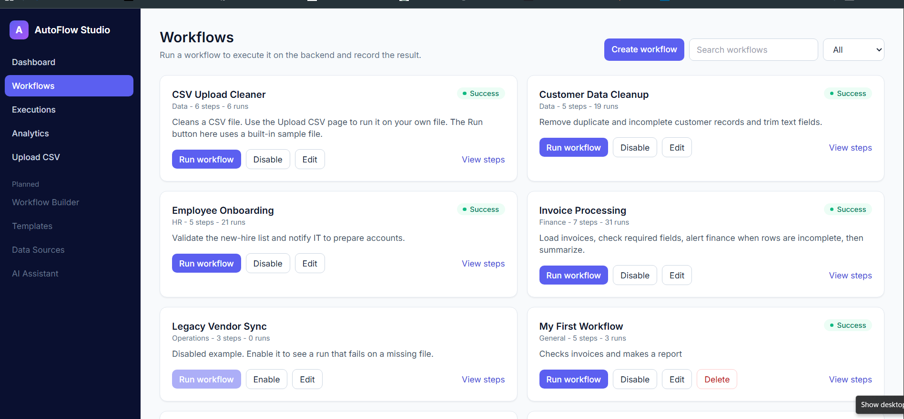
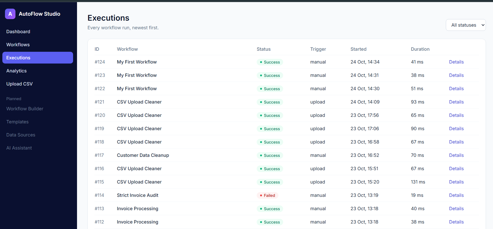
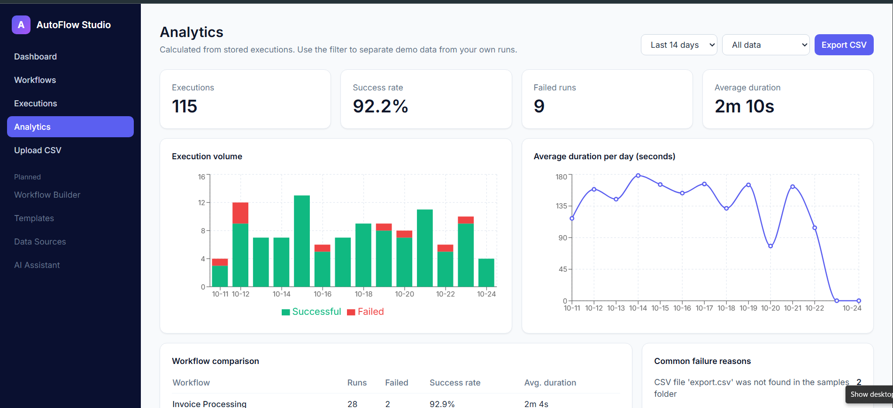
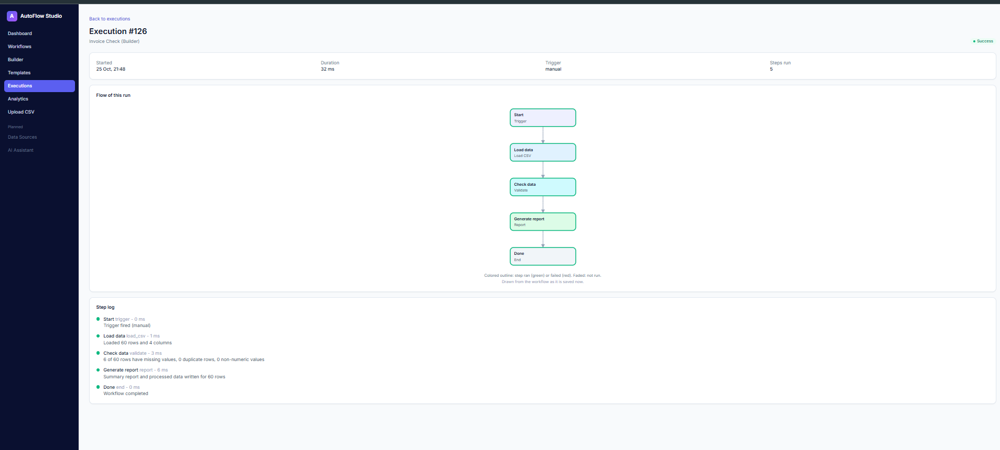

# AutoFlow Studio

A business workflow automation platform. You build workflows from simple steps, run them, and watch the results. Everything runs locally and uses free tools. **All data in this project is fictional.**

> Status: v0.6, work in progress. The sections below say exactly what works and what does not.

## What works today

- **Dashboard.** An automation health view (success ring, runs per day), week-over-week stat cards, average run time per day, a failure summary, workflow status with success bars, recent activity, and quick actions to run a workflow or upload a CSV. All numbers come from the database. "Estimated time saved" is only calculated from a manual time per run that you type in; nothing is assumed.
- **Workflow library.** Search, filter, enable or disable, view steps, and run a workflow. Running starts real processing on the backend.
- **Drag-and-drop builder.** Drag steps onto a canvas, draw arrows between them, click a box to change its settings, and save. A drawing is checked before saving (one Trigger, no loose ends). Built with React Flow (MIT license).
- **Form editor.** The same workflows can also be edited with a plain form. Add steps, reorder them, set retries, and branch with an if/else condition.
- **Execution engine.** Runs steps in order, follows branches, retries failed steps, and records every step with its time and message. Only a fixed list of step types can run, so no user-written code is ever executed.
- **Flow diagrams.** Every workflow is drawn as boxes and arrows, with true/false branches. On a run's page the path that run took is colored.
- **Templates.** Five ready-made workflows. One click makes your own editable copy.
- **Execution history.** Every run with status, duration, trigger, error message and a step-by-step log.
- **CSV upload and cleaning.** Upload a CSV (max 5 MB). The app finds missing values, duplicates and text where numbers should be, cleans the file, and offers the cleaned file and a summary for download.
- **Analytics.** Volume and duration charts, workflow comparison, common failure reasons, and a CSV export. A filter separates seeded demo data from your own runs.
- **Tests.** 37 backend tests (pytest) and 23 frontend tests (Vitest).

## Not built yet

Scheduling, AI assistant, a Data Sources page, user accounts. Notification steps only write to the log. Nothing is emailed.

## Technology (all free)

React, TypeScript, Vite, Tailwind CSS, Recharts, React Flow, Python, FastAPI, SQLAlchemy, SQLite, Pandas, pytest, Vitest.

## Run it on Windows 11

You need Python 3.12 or 3.13 and Node.js 20 or newer. Use two PowerShell windows and run the commands one at a time.

**Window 1: backend**
```powershell
cd autoflow-studio\backend
py -3.13 -m venv .venv
.venv\Scripts\Activate.ps1
pip install -r requirements.txt
python -m pytest
python -m uvicorn app.main:app --port 8000
```

**Window 2: frontend**
```powershell
cd autoflow-studio\frontend
npm install
npm test
npm run dev
```

Open http://localhost:5173. The API documentation is at http://127.0.0.1:8000/docs.

## How it is built

```
backend/app/
  main.py         API routes and a consistent error format
  engine.py       workflow execution (whitelisted step types)
  definitions.py  checks every workflow the editor saves
  analytics.py    dashboard and analytics numbers, CSV export
  models.py       Workflow, Execution, ExecutionStep tables
  seed.py         fictional sample data (safe to run many times)
  templates.py    ready-made workflow templates
frontend/src/
  pages/          Dashboard, Workflows, Builder, Editor, Templates, Executions, Analytics, Upload
  flow.ts         layout and checks for the flow diagrams and the builder
  components/     shared UI and the flow diagram
```

## Safety choices

- Workflows are data, not code. Unknown step types and settings are rejected.
- CSV files are read only from fixed folders, and uploads are stored under random names.
- Uploads are limited by type, size (5 MB) and row count (50,000).
- Exported CSV files neutralise text that Excel could treat as a formula.

## Known limitations

- Runs happen inside the web request, which is fine for small files. A background queue is the next step for long jobs.
- No login yet, so do not put this on the internet.
- The database has no migration tool yet. Add one (Alembic) before changing tables on real data.

## Screenshots

**Dashboard.** Automation health, runs per day, week-over-week stat cards and quick actions. Every number is calculated from stored executions.



**Dashboard, lower half.** Workflow status with success bars, a failure summary, and recent activity.



**Workflow library.** Run, edit, enable or disable workflows.



**Execution log.** Every step of a run, with timing and error messages.



**Analytics.** Volume, duration, workflow comparison and failure reasons.



**Drag-and-drop builder.** Drag steps onto the canvas, draw arrows, and edit a box's settings on the right.



**Flow of a run.** The diagram colors the path a run took.


All data shown is fictional.
